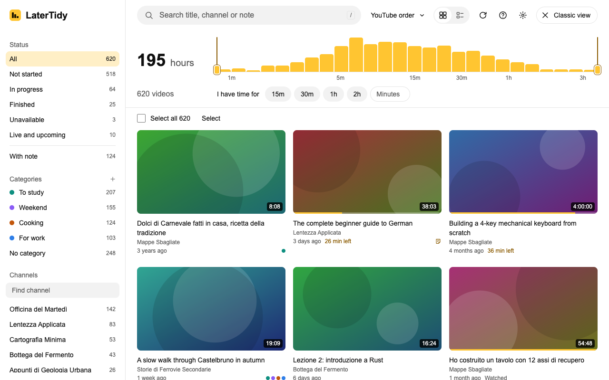
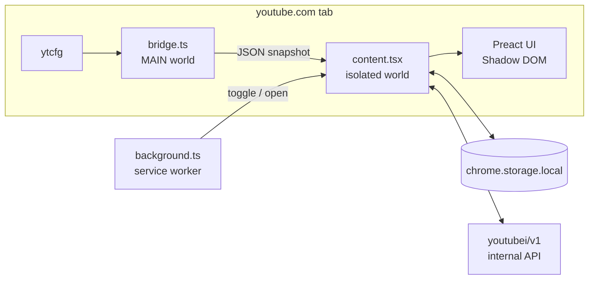

<div align="center">


# LaterTidy

**A structured, keyboard-driven view of your YouTube Watch Later list.**

Search it, filter it, measure it and clean it up, without leaving YouTube.


</div>

## Table of contents

- [Overview](#overview)
- [Features](#features)
- [Quick start](#quick-start)
  - [Build](#1-build)
  - [Load into Chrome](#2-load-into-chrome)
  - [Update](#3-update)
  - [Troubleshooting](#troubleshooting)
- [Usage](#usage)
- [Architecture](#architecture)
  - [Design notes](#design-notes)
  - [Storage](#storage)
  - [Permissions](#permissions)
- [Development](#development)
- [Project status](#project-status)
- [Contributing](#contributing)
- [Publishing](#publishing)
- [Author and license](#author-and-license)
- [Disclaimer](#disclaimer)

## Overview

Saving a video to Watch Later takes one click. Finding it again does not. After a few hundred entries the playlist becomes a single flat column with no categories, little sense of how much is in there and no fast way to clear it out.

LaterTidy is a Chrome extension that adds the missing management layer. It opens a full-screen interface over youtube.com and works on your existing playlist and session: no separate account, no sync service, no backend.

> [!IMPORTANT]
> LaterTidy is pre-release. It passes its test suite against a simulated YouTube, but it has **not yet run on the live site**. See [Project status](#project-status) before using it on your own account.

## Features

| Area | What you get |
| --- | --- |
| **Time accounting** | Total time left to watch, counting only the unwatched part of videos in progress |
| **Duration histogram** | Length distribution with draggable range handles that filter the list |
| **Search** | Instant, accent-insensitive search across title, channel and notes |
| **Filters** | Composable filters by status, channel, category, length and notes |
| **Categories** | Local, many-to-many labels with a "No category" triage view |
| **Notes** | One free-text note per video, included in search |
| **Bulk removal** | Filter, select all, remove, with up to 8 seconds to undo before sending |
| **Time budget** | Enter the time you have and get a queue that fits |
| **Scale** | Virtualized grid and list views, up to 5,000 videos |
| **Playlists** | Add to other playlists; move to top or bottom where YouTube allows it |
| **Export** | JSON and CSV export, plus JSON backup and merge-on-import |
| **Keyboard** | Every action is available from the keyboard |
| **Localization** | English and Italian; theme and language follow YouTube |

Sorting in LaterTidy only affects the view. It never changes the order on YouTube.

<div align="center">
<picture>
  <source media="(prefers-color-scheme: dark)" srcset="store/screenshots/01-overview-dark.png">
  
</picture>
<br>
<sub>Synthetic sample data</sub>
</div>

## Quick start

LaterTidy is not on the Chrome Web Store yet, so you build it from source and load it into Chrome as an unpacked extension. Build output is not committed to the repository.

**Requirements:** Node.js 22 or 24 LTS (recommended), npm and Chrome 111+. The build also supports Node.js 20.

### 1. Build

```bash
git clone https://github.com/mattdev-sh/LaterTidy.git
cd LaterTidy
npm ci
npm run build
```

This creates the `dist/` folder, which is the complete extension.

### 2. Load into Chrome

1. Go to `chrome://extensions`.
2. Turn on **Developer mode** in the top-right corner.
3. Click **Load unpacked**.
4. Select the `dist/` folder, not the repository root.
5. Open [youtube.com](https://www.youtube.com) while signed in, or refresh any YouTube tab that was already open.

To keep the toolbar icon visible, pin LaterTidy from Chrome's extensions menu.

### 3. Update

```bash
git pull
npm ci
npm run build
```

Then click the reload icon on the LaterTidy card in `chrome://extensions` and refresh the YouTube tab. During development, `npm run watch` rebuilds on change, but you still need to reload the extension and the tab.

### Troubleshooting

| Symptom | Fix |
| --- | --- |
| Chrome says the manifest is missing | You selected the repository root. Select `dist/` |
| `dist/` does not exist | Run `npm ci` and `npm run build` |
| No LaterTidy button on YouTube | Refresh the tab, since tabs opened before installation have no content script |
| LaterTidy asks you to sign in | Sign in to YouTube in the same Chrome profile |
| Changes do not appear | Reload the extension, then refresh the tab |

> [!WARNING]
> Write calls have never been exercised on a real account. For your first test, remove one or two videos you can easily add back.

## Usage

Open LaterTidy from the toolbar icon, the masthead button, `Alt+Shift+L`, or by visiting `youtube.com/playlist?list=WL`. **Classic view** returns to the regular YouTube page.

| Key | Action |
| --- | --- |
| `/` | Search |
| `j` `k` or arrows | Move between videos |
| `x` | Select |
| `Enter` | Open |
| `e` or `Delete` | Remove |
| `u` | Undo |
| `c` | Categories |
| `n` | Note |
| `b` | Time budget |
| `g` | Toggle grid and list |
| `?` | Help |
| `Esc` | Close popover, then clear search, then selection, then exit |

## Architecture

Manifest V3 extension written in TypeScript and Preact, bundled with esbuild. It has no runtime dependency beyond Preact and loads no remote code.



```text
src/
├── entry/
│   ├── bridge.ts       MAIN world: replies only with a JSON copy of ytcfg
│   ├── content.tsx     Isolated world: bootstrap, Shadow DOM, masthead button, SPA navigation
│   └── background.ts   Service worker: toolbar action and keyboard command
├── app/
│   ├── app.ts          State and actions
│   └── keys.ts         Keyboard isolation and key layers
├── core/               Pure, tested logic: parser, API, filters, removal queue, metadata, backup
├── ui/                 Preact components and CSS
└── i18n.ts             English and Italian dictionaries
e2e/                    Playwright specs and the simulated YouTube
tests/                  Vitest unit tests
store/                  Chrome Web Store listing and screenshots
```

### Design notes

- **UI isolation.** Preact renders into a Shadow DOM on `document.documentElement`. CSS lives in a constructable stylesheet, so the page CSP does not interfere. There is no `innerHTML`.
- **Keyboard isolation.** While LaterTidy is open, a capture-phase listener on `window` stops every key before YouTube sees it. Components therefore use `useKeyLayer` instead of `onKeyDown`.
- **Trust boundary.** The bridge exposes nothing but a JSON snapshot of `ytcfg`, and `sanitizeConfig` revalidates it on the isolated side.
- **Authentication.** `youtubei/v1` requests carry the session cookies and a `SAPISIDHASH` header, derived from `SAPISID` or, when it is unavailable, `__Secure-3PAPISID`. Nothing is stored or sent anywhere else.
- **Removal pipeline.** Removal is optimistic, then deferred (`src/core/removal.ts`). Requests run sequentially in chunks of 25, retry on 429 and 5xx with exponential backoff, and failed items return to their original position. Removing 50 or more videos takes a two-step confirmation.
- **Undo window.** You have up to 8 seconds to undo the latest removal batch. Starting another batch, navigating within YouTube, or leaving the page commits it early. Switching accounts or signing out discards removals that have not been sent. Requests already accepted by YouTube cannot be undone.
- **Page unload.** Pending removals are flushed with `fetch` `keepalive`, which has a 64 KiB in-flight limit. Whatever does not fit is persisted and retried on the next visit.
- **Parser resilience.** The parser searches for structures generically to survive small response changes. If a larger change breaks loading, LaterTidy reports it and offers the classic view.

### Storage

Persistent state lives in `chrome.storage.local`. Playlists, categories, notes and pending removals are separated by a hash of `DATASYNC_ID` (falling back to the session index when that ID is unavailable). Settings are shared across accounts in the same Chrome profile.

| Key | Contents |
| --- | --- |
| `lb:v1:<acct>` | Cached playlist |
| `lb:v1:<acct>:meta` | Categories and notes, never touched by a refresh |
| `lb:v1:<acct>:pending` | Removal entry IDs that did not fit the unload request budget |
| `lb:settings` | Settings shared across accounts |

Categories and notes do not sync between devices and are never sent to YouTube. Uninstalling the extension or using **Clear local data** deletes them, so export a JSON backup from Settings first. Importing merges without creating duplicates.

### Permissions

| Permission | Why |
| --- | --- |
| `storage` | Persists the cached list, categories, notes and settings locally |
| `https://www.youtube.com/*` | Injects the interface and calls YouTube with the existing session |

LaterTidy has no developer-operated servers or analytics. API calls go to YouTube; video thumbnails load from YouTube image hosts such as `i.ytimg.com`. The sign-in link opens Google Accounts. See [PRIVACY.md](PRIVACY.md).

## Development

| Command | Description |
| --- | --- |
| `npm run build` | Build into `dist/` |
| `npm run watch` | Rebuild on change |
| `npm run typecheck` | Type-check the project |
| `npm test` | Run unit tests with Vitest |
| `npm run test:e2e` | Build and run E2E tests with Playwright |
| `npm run shots` | Regenerate `store/screenshots/` from synthetic data |
| `npm run zip` | Create `release/latertidy-<version>.zip` from `dist/` |

E2E tests need a one-time `npx playwright install chromium`. They run the built extension in Chromium against a simulated youtube.com (`e2e/mock/`), with no real account. The harness blocks unmocked HTTP(S) requests so they cannot reach the live site.

## Project status

| Component | Verification |
| --- | --- |
| UI and user flows | Automated E2E tests against the mock |
| Read response shapes | Checked live, read-only, on 2026-11-03 |
| Extension code on the live site | **Not yet run** |
| `edit_playlist` writes (remove, move, add) | **Never run live.** Modeled on the requests made by YouTube's own menu |
| `fetch` from the isolated world | Mock only |
| `fetch keepalive` during a real page close | Mock only. Sent requests are not acknowledged during teardown; the next refresh reconciles the list with YouTube |

### Known risk: internal API

LaterTidy relies on `youtubei/v1`, the private API behind the YouTube website. It is undocumented and can change without notice, so any release can break when YouTube changes it.

## Contributing

The most valuable contribution right now is testing on the live site and reporting what breaks. Loading failures usually point to `src/core/parser.ts`.

Before opening a pull request:

1. Run `npm run typecheck`, `npm test` and `npm run test:e2e`.
2. Add or update tests: `e2e/` for UI behavior, `tests/` for logic.
3. Use synthetic data only. Do not commit real YouTube responses, cookies, personal lists or real thumbnails.
4. Write code and comments in English, and add every UI string to `src/i18n.ts` in both languages.

## Publishing

`store/listing.md` and `PRIVACY.md` hold the Chrome Web Store copy, permission justifications and privacy policy, and `store/screenshots/` holds the images. Upload the archive produced by `npm run zip`. The privacy policy URL and contact email placeholders must be filled in first.

### Files to publish

Commit source code, tests, synthetic screenshots, documentation, `package.json`
and `package-lock.json`. The `.gitignore` excludes dependencies, build output,
release ZIPs, editor files, test reports, local credentials and common debug
captures. Never commit account cookies, browser profiles, real API responses or
personal exports; a file renamed outside the ignored patterns still needs review.
Use Git to publish the repository rather than uploading the whole working folder.
Before publishing, inspect both `git status --short` and `git diff --cached`:
ignore rules do not remove files that are already tracked.

## Author and license

Created by [Matteo Mangia (@mattdev-sh)](https://github.com/mattdev-sh).

LaterTidy is **source available** under the custom [LaterTidy Source Available License 1.0](LICENSE).
You may use it for free, fork it, modify it however you like, and share original
or modified versions for free under the same license. Internal business use is
also allowed. Selling, charging for access, or monetizing LaterTidy or modified
versions requires separate written permission. See [LICENSE](LICENSE) for the
full terms, including attribution and redistribution conditions.

This is not an OSI-approved open-source license because it restricts commercial
distribution. Third-party components retain their own licenses; see
[THIRD_PARTY_NOTICES](THIRD_PARTY_NOTICES).

## Disclaimer

LaterTidy is an independent project. It is not affiliated with, endorsed by or sponsored by YouTube or Google.
